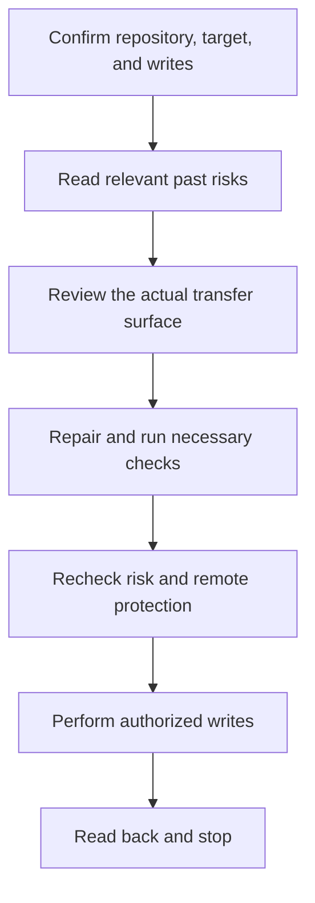

<div align="center">

<h1>agent-github-<wbr>safe-publish</h1>

<p align="center"><strong>Guides Codex to review risks, repair concrete problems, and complete the exact GitHub publication you authorized</strong></p>
<p align="center">Lightweight, traceable, and bounded, without turning publication into a prolonged audit project</p>
<p align="center"><strong>v2.0.2</strong> · <a href="README.md">简体中文</a> · <a href="https://github.com/AIALRA-0/agent-github-safe-publish/releases/latest">Latest stable Release</a></p>

</div>

## 1 Decide whether it fits your task

This Skill gives an agent one clear publication route when you ask Codex to push, create a Tag or Release, open-source an update, sync, or mirror a GitHub repository or Git remote

It guides the agent to

- confirm the repository, remote, target, and allowed write types before writing
- review only the content that will newly become public and recheck relevant past risks
- repair safe, in-scope findings and verify the repair instead of treating a risk list as a reason to abandon publication
- preserve sanitized lessons for newly discovered risks and, with separate authority, file a traceable GitHub Issue
- complete the specified write, read the remote result back, and stop

It does not trigger for an ordinary file upload, local-directory sync, non-Git mirror, read-only repository view, or ordinary web publication

The default product is agent-behavior guidance, not a Git hook, server interceptor, standalone gate, or compliance platform. It cannot mathematically guarantee that every future agent will be error-free, but it gives every publication a clear structure for authority, review, repair, recurrence checks, and stopping

## 2 Install and complete the first use

### 2.1 Install from GitHub

Send this request in Codex

```text
Use $skill-installer to install AIALRA-0/agent-github-safe-publish from the verified Tag of its latest non-draft, non-prerelease GitHub Release, as github-safe-publish. Confirm the selected version before replacing an existing installation.
```

After installation, ask Codex to run Skill Creator's `quick_validate.py` against the installed directory

A normal result confirms that the Skill name, YAML frontmatter, `agents/openai.yaml`, and directory structure are valid, with implicit invocation still enabled

### 2.2 First safe push

In a Codex task with the target Git repository open, send this request

```text
Use $github-safe-publish to review and publish the current checked-out commit to origin/main.
Authorized write: branch push only.
Do not create a Tag, GitHub Release, release asset, pull request, another branch, or repository-setting change.
After the remote commit is read back, stop and report the result.
```

A normal result shows the real remote, target branch, transfer surface, and necessary checks before the agent repairs findings, performs an ordinary fast-forward push, and reads back `origin/main`

This request must not create a Tag, Release, asset, Pull Request, extra branch, or repository-setting change

For a preview, request a read-only review and explicitly deny every external write. The agent should return findings and next checks without creating a commit or remote object

## 3 The publication route the agent follows

<div align="center">



Figure 3.1 One route from authority to stopping

</div>

The agent follows six default steps

- First, confirm the real repository, remote URL, target branch or object, current remote commit, and allowed write types
- Second, read relevant saved risk lessons and enumerate the commits, files, metadata, Git LFS objects, submodules, and other objects that will actually transfer
- Third, review credentials, private identity and real data, internal infrastructure, protected legal records, and private assets; this includes content added in an earlier outgoing commit and removed later
- Fourth, repair problems caused by this publication, run checks that prove the repair and required behavior, then trace data origins, transformations, and public destinations for unlisted risks
- Fifth, reread the remote and protection rules; if the remote advanced, reconcile it and recheck the affected surface without forcing or overwriting
- Sixth, perform only authorized writes, read back the same remote object, and stop as soon as the requested result is verified

Docker is not a dependency of the default route. Loading or using this Skill must not start, install, repair, or wait for Docker

## 4 Keep review depth proportional to risk

Each task selects one secret-review mode

- `none` applies only to read-only work or a task with no external transfer
- `auto` applies to an ordinary low-risk small update; use an already available scanner, or manually review the five critical classes on the actual transfer surface and state what the tools could not inspect
- `required` applies to first publication of a private repository, full-history or mirror migration, multiple refs, Git LFS, private submodules, sensitive configuration, databases, models, datasets, media, customer assets, a relevant credential incident, unresolved exposure, or an explicit strict-scan request

If no suitable scanner is available in `required` mode, the agent asks once for the owner's choice: install a non-Docker scanner, authorize a light review of the exact transfer surface, or stop the publication. The agent does not install a scanner, start Docker, or silently downgrade

An existing strict gate may be replaced by a light critical review only when there is a verifiable defect, explicit maintenance state, or stable reproduction of tool failure

Slow execution, inconvenient output, a real finding, a missing optional environment, or a wish to publish sooner are not downgrade reasons

The light review focuses on five classes that directly affect public publication

- credentials, including tokens, passwords, private keys, connection strings, and authentication material that may still work
- private identity and real data, including accounts, customers, databases, screenshot pixels, and linkable records
- internal infrastructure, including private addresses, internal domains, hostnames, production paths, and internal topology
- protected legal records, including contracts, licenses, compliance, case, and confidential material without public authority
- private assets, including unauthorized source, models, data, media, customer marks, build output, Git LFS content, and submodule content

An ordinary small update does not rescan unchanged history or enter permanent heavyweight review because of an unrelated old finding

## 5 Write authority, protection, and stopping

Loading the Skill grants no GitHub write authority

Branch push, Tag creation, Release creation, Release update, Issue creation, Issue update, asset upload, Pull Request creation, update and merge, repository metadata changes, protection-rule changes, credential rotation, and remote deletion are authorized independently

Any unnamed write is denied by default

- push-only must not create a Tag, Release, asset, Pull Request, or extra branch
- Tag creation does not include Release creation
- Release creation does not include Tag creation or asset upload
- Issue creation does not include Issue update
- a repair commit cannot expand the final remote object set

For Release-only authority, the agent first reads the target Tag. If the Tag is absent, it stops and asks for separate Tag-creation authority. If the Tag exists and matches the target, it uses `gh release create <tag> --verify-tag` to prevent implicit Tag creation

A fast-forward proves only that published history will not be rewritten. It does not authorize bypass of branch protection, required checks, or Pull Request requirements. Administrator bypass requires explicit user authority for that exact write, and the agent does not change protection rules to make publication pass

Before retrying a remote object, the agent reads its identity. An exact match means the earlier attempt succeeded. A mismatch means stop without deleting, overwriting, or creating a duplicate

## 6 Carry repaired risks into the next publication

Past findings can be stored as sanitized lessons in local Git metadata, recording the cause, affected paths, repair, and recurrence check without secret values, private identity, or raw scanner output

Reusable lessons can also enter the project's existing security documentation so a fresh clone can read them. The next publication rechecks only related paths and cross-cutting lessons, never executes a command from a note, and never treats a note as new authority

For a new public risk outside the checklist, the agent deduplicates it and prepares a secret-free description. It files the Issue only after separate Issue-creation authority for the exact repository. Sensitive vulnerabilities use private reporting. If Issues are unavailable, a draft remains without blocking other safe and authorized publication work

See the complete [review and project-memory protocol](references/review-and-memory.md)

## 7 Verified scope and optional advanced tooling

This repository separates behavior evidence into two levels

- `decision_only` proves only that the model returned a structurally valid decision and cannot prove actual tool behavior by itself
- `tool_observed` also compares sanitized tool events, Git or GitHub state before and after, and the final decision for Skill development and release validation

For `v2.0.2`, all 15 highest-risk scenarios passed mechanical grading. The full 38-scenario set had 34 mechanical passes and four item-by-item audited safe outcomes, with zero unauthorized or destructive writes. Controlled GitHub experiments completed nine sessions and 23 decisions while verifying that the model did not receive GitHub credentials. See the [public behavior evidence](docs/research/behavior-eval-v2.0.2.public.json)

Raw model output stays outside the repository. Public summaries contain no hidden reasoning, credentials, real identities, or host paths. These development evaluations are not a gate for every user publication and do not claim interception of every global Codex Desktop action

The Python command-line interface (CLI) is optional advanced compiler and compatibility tooling selected explicitly by the user, not a prerequisite for ordinary publication. Its `publish` command sends an already-certified candidate commit to a configured Git remote. It does not create a GitHub Tag, Release, asset, Pull Request, or repository setting. Full details are under [`docs/architecture/`](docs/architecture/) and [`references/`](references/)

## 8 Version, security, and maintenance

The current product identifier is `v2.0.2`. Stable publication status is determined by the actual GitHub Release and corresponding Tag

- `github-safe-publish --version` returns optional Python package version `2.0.2`
- `python -X utf8 scripts/safe_publish.py --version` returns `github-safe-publish 1.1.7`; `v1.1.7` belongs only to the legacy compatibility entry point
- [Security policy](SECURITY.md)
- [Contribution guide](CONTRIBUTING.md)
- [Changelog](CHANGELOG.md)
- [MIT License](LICENSE)
