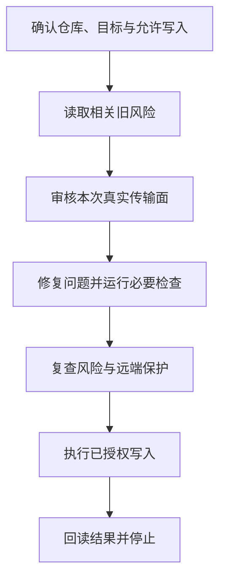

<div align="center">

<h1>agent-github-<wbr>safe-publish</h1>

<p align="center"><strong>让 Codex 在发布 GitHub 项目时先审清风险、直接修复问题，再完成你明确要求的写入</strong></p>
<p align="center">轻量、可追踪、有明确终点，不把发布变成漫长的审计工程</p>
<p align="center"><strong>v2.0.2</strong> · <a href="README.en.md">English</a> · <a href="https://github.com/AIALRA-0/agent-github-safe-publish/releases/latest">最新正式 Release</a></p>

</div>

## 1 先判断它是否适合你

当你要求 Codex 向 GitHub 仓库或 Git 远端执行 push、Tag、Release、开源更新、同步或镜像时，本 Skill 为 Agent 提供一条不会迷路的发布路线

它会帮助 Agent 完成这些事情

- 先确认仓库、远端、目标和你允许的写入类型
- 只审核本次真正要公开的新内容，并检查过去相关风险是否复发
- 发现可修复问题时直接修复并复查，不把风险清单当成拒绝发布的理由
- 发现现有清单没有覆盖的新风险时，保存脱敏教训，并在另行授权后提交可追踪的 GitHub Issue
- 完成指定写入并回读远端结果，随后立即停止

它不会因为普通文件上传、本地目录同步、非 Git 数据镜像、只读浏览仓库或普通网页发布而触发

默认产品是行为指导 Skill，不是 Git Hook、服务器拦截器、独立 Gate 或合规平台；它不能数学保证任何未来 Agent 永不犯错，但会把每次发布的授权、审核、修复、复发检查和停止点组织清楚

## 2 安装并完成第一次使用

### 2.1 从 GitHub 安装

在 Codex 中发送下面的请求

```text
Use $skill-installer to install AIALRA-0/agent-github-safe-publish from the verified Tag of its latest non-draft, non-prerelease GitHub Release, as github-safe-publish. Confirm the selected version before replacing an existing installation.
```

安装后，请 Codex 使用 Skill Creator 的 `quick_validate.py` 检查安装目录

正常结果应确认 Skill 名称、YAML Frontmatter、`agents/openai.yaml` 和目录结构有效，并且隐式调用仍为启用

### 2.2 第一次安全推送

在已经打开目标 Git 仓库的 Codex 任务中发送下面的请求

```text
Use $github-safe-publish to review and publish the current checked-out commit to origin/main.
Authorized write: branch push only.
Do not create a Tag, GitHub Release, release asset, pull request, another branch, or repository-setting change.
After the remote commit is read back, stop and report the result.
```

正常结果是 Agent 先说明真实远端、目标分支、本次传输内容和必要检查，修复发现的问题后执行普通快进推送，最后回读 `origin/main`

本次请求不得产生 Tag、Release、附件、Pull Request、额外分支或仓库设置变化

只想先看结果时，将请求改成只读审阅，并明确禁止所有外部写入；Agent 应返回风险与下一步，不应创建提交或远端对象

## 3 Agent 实际遵循的发布路线

<div align="center">



图 3.1 从授权到停止的单一路线

</div>

Agent 默认按下面六步工作

- 第一步，确认真实仓库、远端地址、目标分支或对象、远端当前提交，以及你允许的写入类型
- 第二步，读取项目保存的相关旧风险，并列出本次真正会传输的提交、文件、元数据、Git 大文件和子模块等对象
- 第三步，审核凭据、私人身份与真实数据、内部基础设施、受保护法律记录和私有资产；前面新增、后来删除但仍会随提交历史传输的内容也在范围内
- 第四步，直接修复与本次发布有关的问题，运行能够证明修复和必要功能有效的检查，再从数据来源、加工过程和公开出口寻找遗漏风险
- 第五步，重新读取远端与保护规则；远端已经前进时先协调新状态并重查受影响内容，不强推或覆盖
- 第六步，只执行已授权写入，回读同一远端对象；达到用户指定结果后立即停止

Docker 不是默认路径的依赖；加载或使用本 Skill 不得启动、安装、修复或等待 Docker

## 4 审核深度保持与风险相称

每次任务选择一种秘密审核档位

- `none` 只用于纯只读任务或没有外部传输的任务
- `auto` 用于普通、低风险、小范围更新；已有扫描器就补充使用，没有时只人工审核本次真实传输面中的五类关键内容，并说明工具看不到的部分
- `required` 用于私有仓库首次开源、全历史或镜像迁移、多 ref、Git 大文件、私有子模块、敏感配置、数据库、模型、数据集、媒体、客户资产、相关凭据事故、未解决泄露，或用户明确要求严格扫描的任务

`required` 缺少合适扫描器时，Agent 只询问一次，由所有者选择安装非 Docker 扫描器、授权精确传输面的轻量人工审核，或停止本次发布；Agent 不自行安装扫描器、不启动 Docker，也不静默降低审核级别

已有严格门禁只有在存在可核对缺陷、明确维修状态，或相同输入稳定复现工具故障时，才能临时改用轻量关键审核

运行较慢、结果不方便、发现真实风险、缺少可选环境或想尽快发布，都不能作为降级理由

轻量审核聚焦五类会直接影响公开发布的内容

- 凭据覆盖令牌、密码、私钥、连接字符串和仍可能有效的认证材料
- 私人身份与真实数据覆盖账户、客户、数据库、截图像素和可关联记录
- 内部基础设施覆盖私有地址、内部域名、主机名、生产路径和内部拓扑
- 受保护法律记录覆盖未公开授权的合同、许可、合规、案件和保密材料
- 私有资产覆盖未授权源码、模型、数据、媒体、客户标志、构建产物、Git 大文件内容和子模块内容

普通小改动不会重复扫描没有变化的全部历史，也不会因为无关旧问题进入长期重载审核

## 5 写入授权、保护规则与停止点

加载 Skill 不会自动获得任何 GitHub 写入权限

branch push、Tag 创建、Release 创建、Release 更新、Issue 创建、Issue 更新、附件上传、Pull Request 创建、更新与合并、仓库元数据修改、保护规则修改、凭据轮换和远端删除都需要分别授权

未点名的写入默认禁止

- push-only 不得创建 Tag、Release、附件、Pull Request 或额外分支
- Tag 创建不自动包含 Release
- Release 创建不自动包含 Tag 创建或附件
- Issue 创建不自动包含 Issue 更新
- 修复提交不能扩大最终远端对象集合

只授权创建 Release 时，Agent 必须先读取目标 Tag；Tag 不存在就停止并请求独立的 Tag 创建授权；Tag 已存在且目标一致时使用 `gh release create <tag> --verify-tag`，避免命令隐式创建 Tag

普通快进只能证明不会改写历史，不能授权绕过分支保护、必需检查或 Pull Request 要求；需要管理员绕过时，必须由用户针对本次精确写入明确授权；Agent 不会为了发布而修改保护规则

远端对象重试前先回读身份；完全一致视为前次操作已经成功；不一致就停止，不删除、不覆盖、不创建重复对象

## 6 让风险修复能够延续到下一次发布

项目以前发现的问题可以作为脱敏教训保存在 Git 的本地管理目录，记录原因、影响路径、修复方法和复发检查，不保存秘密值、私人身份或原始扫描输出

具有跨克隆价值的通用教训可以进入项目已有安全文档；下次发布只重查与当前改动有关的路径和跨项目风险，不执行记录中的命令，也不把记录当成新增权限

发现清单未覆盖的新公开风险时，Agent 会先去重并生成不含秘密的说明；只有用户另行授权 Issue 创建后，才会提交到指定仓库；敏感漏洞使用私密报告，Issue 不可用时保留草稿，不阻挡其他已经安全且获授权的发布工作

完整规则见[审核与项目记忆](references/review-and-memory.md)

## 7 已验证范围与可选高级工具

本仓库的行为证据分成两层

- `decision_only` 只证明模型返回了结构正确的决策，不能单独证明真实工具行为
- `tool_observed` 同时核对脱敏工具事件、Git 或 GitHub 前后状态以及最终决策，用于本 Skill 的开发和发布验收

`v2.0.2` 的 15 个最高风险场景全部机械通过；完整 38 场景组包含 34 个机械通过和 4 个逐项人工复核通过，未授权或破坏性写入为零；受控 GitHub 实验完成 9 个会话和 23 次决策，并验证模型没有获得 GitHub 凭据；详见[公开行为证据](docs/research/behavior-eval-v2.0.2.public.json)

原始模型输出保存在仓库外；公开汇总不包含隐藏思维链、凭据、真实身份或本机路径；这些开发评测不是用户每次发布都要运行的 Gate，也不代表能够截获 Codex Desktop 的全部全局动作

Python 命令行界面（Command Line Interface，CLI）是用户明确选择后才使用的高级编译与兼容工具，不是普通发布的前置条件；其 `publish` 只把已认证候选提交发布到配置的 Git 远端，不创建 GitHub Tag、Release、附件、Pull Request 或仓库设置；完整资料位于 [`docs/architecture/`](docs/architecture/) 和 [`references/`](references/)

GitHub 的命令行界面（Command Line Interface，CLI）只在需要认证的远端读取或写入时使用

持续集成（Continuous Integration，CI）是在每次代码变更时自动运行检查的流程；本 Skill 只跟进与本次发布直接相关的结果

以 `--` 开头的参数指定输入、输出和发布档位

## 8 版本、安全与维护

当前产品标识为 `v2.0.2`，正式发布状态以 GitHub 上实际存在的正式 Release 和对应 Tag 为准

- `github-safe-publish --version` 返回可选 Python 包版本 `2.0.2`
- `python -X utf8 scripts/safe_publish.py --version` 返回 `github-safe-publish 1.1.7`，其中 `v1.1.7` 只属于旧兼容入口
- [安全政策](SECURITY.md)
- [贡献指南](CONTRIBUTING.md)
- [变更记录](CHANGELOG.md)
- [MIT License](LICENSE)
